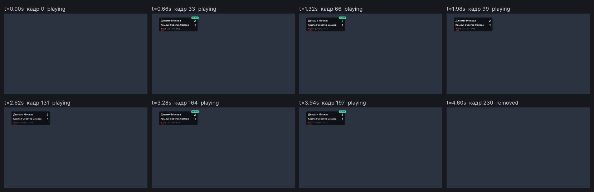

# kine

**English** · [Русский](README.ru.md)

kine renders broadcast graphics and interfaces from TSX without a browser. Its primary author is an
AI agent, so besides pixels kine returns structure: a text dump of the scene tree, where every
value came from, and diagnostics that point to a line of TSX.



A component, shortened from [examples/lower-third](examples/lower-third/LowerThird.tsx):

```tsx
export const LowerThird = component({
  name: 'LowerThird',
  props: { name: String, role: String, live: Boolean },
  parts: ['panel', 'dot', 'title', 'subtitle'],
  view: ({ name, role, live }, part) => (
    <Box name={part.panel} anchor={{ to: 'titleSafe', at: 'bottom-left' }} must={{ inside: 'titleSafe' }}
         look={[{ background: theme.color.surface, padding: [16, 24], radius: 12 }, on(live, { background: theme.color.surfaceLive })]}>
      <Box name={part.dot} when={live} presence={{ loop: pulse({ period: 1.2, opacity: [1, 0.4] }) }} />
      <Text name={part.title} fit={{ shrinkTo: 32 }} must={{ fit: true, contrast: 4.5 }}
            else={[{ shrinkTo: 28 }, { shrinkTo: 28, lines: 2 }]}>{name}</Text>
      <Text name={part.subtitle}>{role}</Text>
    </Box>
  ),
  presence: { in: [slide({ x: [-40, 0] }, spring.snappy), fade([0, 1])], out: fade([1, 0]) },
});
```

What an agent reads back (`kine dump examples/lower-third/scene.tsx`, abridged):

```
└─ LowerThird#1/panel  box row gap 16  (96,884 521×142)  bg color.surfaceLive · r 12 · pad 16,24 · border 2 color.accent (look[1] on)  [must inside]
   ├─ LowerThird#1/dot  box  (122,947 16×16)  bg color.accent · r 8  motion opacity×0.47  [loop]
   └─ LowerThird#1/panel/box[1]  box column gap 4  (154,902 437×106)
      ├─ LowerThird#1/title  text  (154,902 437×68)  "Анна Смирнова"  Inter 600 56px · color.text  [must fit,contrast]  [else×3]
      └─ LowerThird#1/subtitle  text  (154,974 437×34)  "ВЕДУЩАЯ"  Inter 400 28px · color.muted
```

> **Status: early alpha (0.1.0-alpha.1).** The API changes between minor versions. The Windows
> build is tested by hand; Linux and macOS binaries come from CI. The design document, the built-in
> reference (`kine docs`, `kine explain`) and diagnostics are in Russian for now.

## Why

- **Checked, not eyeballed.** `must` assertions (`fit`, `inside` a safe area, `contrast`, `visible`)
  are errors in development and fall back to declared `else` variants on air. `kine check` runs
  them on every frame of a scenario.
- **Deterministic time.** Motion — transitions, presence, springs, timelines with markers, holds
  and loops — is computed in closed form at any `t`. A frame depends only on its moment; video
  output is byte-reproducible.
- **Built for agents.** Every command has `--json` with a versioned envelope, exit codes, a ready
  `next` command and a `repro` line. Errors carry the TSX location (source maps for JS exceptions).
  The loop "write → check → fix" works through the CLI alone.
- **Broadcast-shaped.** Safe areas (EBU R95), alpha output (ProRes 4444, VP9), operator cues
  `play / next / stop / update` in the CasparCG tradition, component commands with typed params.

## Install

```bash
npm i -D @kine/cli@next typescript
npx kine new lower-third
npx kine check lower-third
npx kine test
npx tsc -p .
```

`@kine/cli` installs the `kine` command, `@kine/core` (scene API, runtime, bundler), esbuild and
the native binary for your platform (win32-x64, linux-x64, darwin-arm64, darwin-x64). `kine new`
creates a scene from a template and, in a fresh project, `tsconfig.json`, `kine.config.ts` and the
Inter font. `npx kine doctor` checks the environment. Video output needs `ffmpeg` in `PATH`.

## Commands

| Command | What it does |
|---|---|
| `kine render <entry> [-o out.png]` | One frame as PNG (transparent unless `--bg`) |
| `kine dump <entry> [--path node] [--depth N]` | Scene tree: node addresses, geometry, styles, motion phases, diagnostics |
| `kine inspect <entry> <node>` | One node: values, the layers and theme tokens they came from, motion channels, source |
| `kine check <entry> [--t a..b]` | `must` and built-in rules on every frame of a range |
| `kine filmstrip <entry> [--t a..b] [--n 8]` | N moments of a range in one image |
| `kine video <entry> [-o out.mov]` | Video through ffmpeg: ProRes 4444, QuickTime Animation, VP9 with alpha, H.264, PNG frames |
| `kine view [entry]` | Local web viewer: gallery of outputs, live scene with a time slider, dump and inspect |
| `kine test [paths] [--update]` | `*.kine.test.ts` cases: clean frames, dump and pixel snapshots |
| `kine perf <entry>` | Frame time by stage against the `1/fps` budget |
| `kine schema <entry>` | Scene props, components, parts, commands, timeline markers |
| `kine explain [rule]` · `kine docs [topic]` | Built-in reference, matching the binary version |
| `kine new <name>` · `kine doctor` · `kine cache [clean]` | Scaffold, environment check, bundle cache |

An entry is a scene (`defineScene`), a cue script (`*.cues.ts`), a scene name from
`kine.config.ts` or a directory with `scene.cues.ts` / `scene.tsx`. Time is one grammar
everywhere: `1.2`, `60f`, `settled`, `out+0.2`, `0..4`, segment names such as `in` or `loop`.

## Develop

Needs Rust (stable; MSVC on Windows) and Node 18+.

```bash
npm install
cargo build
cargo test --workspace
npm run typecheck
cargo run -q -p kine-cli -- render examples/lower-third/scene.tsx --bg "#2b3340" --dump
```

`npm run npm:smoke` builds the npm packages from the release binary and installs them into a clean
project. Releases: `node scripts/version.mjs <version>` bumps the single version in `Cargo.toml`,
then a `v<version>` tag runs `.github/workflows/release.yml`. Changes are listed in
[CHANGELOG.md](CHANGELOG.md).

| Path | Contents |
|---|---|
| `spec/kine.d.ts` | The public API contract (types) and `contract.test.tsx` — errors tsc must catch |
| `packages/core` | `@kine/core`: signals, JSX runtime, primitives, bridge to the native core, `bundle.mjs` |
| `crates/kine-js` | QuickJS host with deterministic time and randomness |
| `crates/kine-core` | Scene tree, `look` with provenance, layout (Taffy), text (parley), motion, `must`, display list, dump |
| `crates/kine-render` | CPU backend (vello_cpu) |
| `crates/kine-cli` | Sessions, the operation layer, JSON output, bundling and cache, tests, video, viewer, `kine` |
| `examples` | Lower third and scoreboard scenes, cue scripts, tests and golden dumps |
| `DESIGN.md` | Design, principles and milestones (in Russian) |

## License

kine is licensed under either of [MIT](LICENSE-MIT) or [Apache-2.0](LICENSE-APACHE) at your
option. Unless you state otherwise, any contribution you submit for inclusion is dual-licensed the
same way, without additional terms. The Inter font in `assets/fonts/inter` is under the
[SIL Open Font License](assets/fonts/inter/OFL.txt). The binary packages ship the licenses of
their dependencies in `THIRD-PARTY-LICENSES.txt`.
